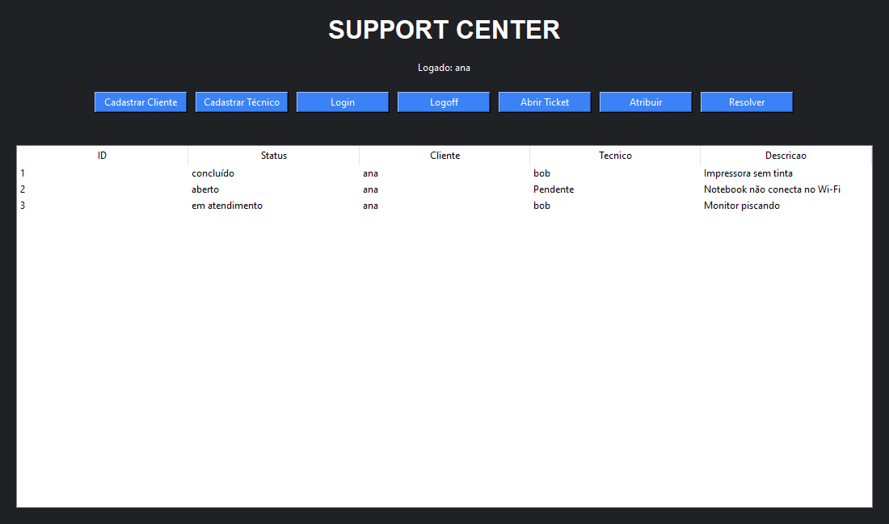

# 🎧 Support Center

Sistema de **help desk** com interface gráfica em **Python + Tkinter**. Clientes abrem chamados (tickets), que são atribuídos a técnicos e resolvidos por eles, tudo acompanhado numa tabela em tempo real.



## 🚀 Funcionalidades

- **Cadastro de usuários:** clientes (com telefone) e técnicos (com especialidade).
- **Login e logoff:** com validação de usuário e senha.
- **Abertura de tickets:** só para usuários logados. Cada ticket entra no histórico do cliente.
- **Atribuição:** um ticket é passado para um técnico e muda para **em atendimento**.
- **Resolução:** só técnicos podem concluir tickets, e o sistema conta quantos cada técnico resolveu.
- **Tabela em tempo real:** ID, status, cliente, técnico e descrição de cada ticket.

### Ciclo de um ticket

```
aberto  ──►  em atendimento  ──►  concluído
        (atribuir)           (resolver, só técnico)
```

## 🛠️ Tecnologias e conceitos aplicados

- **Python 3** e **Tkinter** (`ttk.Treeview`, `simpledialog`, `messagebox`)
- **Programação orientada a objetos:** classes, **herança** (`Usuario` → `Cliente` e `Tecnico`) e `isinstance` para controlar permissões
- **Separação de camadas:** a interface (`frontend.py`) só chama a regra de negócio (`sistema.py`)
- Retornos padronizados (`True` ou mensagem de erro) para a interface mostrar o resultado ao usuário

## 📁 Estrutura

```
├── frontend.py   # Interface gráfica (Tkinter)
├── sistema.py    # Regras de negócio: usuários, login e tickets
├── usuario.py    # Classes Usuario, Cliente e Tecnico
└── ticket.py     # Classe Ticket e atualização de status
```

## 💻 Como executar

**Pré-requisito:** Python 3 instalado. O Tkinter já vem junto no Windows e no macOS. No Linux, instale o pacote `python3-tk`.

```bash
git clone https://github.com/samuelcolpo/support-center-tkinter.git
cd support-center-tkinter
python frontend.py
```

### Roteiro rápido para testar

1. **Cadastrar Cliente** e **Cadastrar Técnico**.
2. **Login** com o cliente e **Abrir Ticket**.
3. **Atribuir** o ticket (pelo ID) ao técnico.
4. **Logoff**, **Login** com o técnico e **Resolver** o ticket.

> Os dados ficam em memória: ao fechar o programa, usuários e tickets são apagados.

## 🔭 Próximos passos

- Salvar usuários e tickets em arquivo ou banco de dados (PostgreSQL)
- Guardar as senhas com hash em vez de texto puro
- Formulários próprios no lugar das caixas de diálogo
